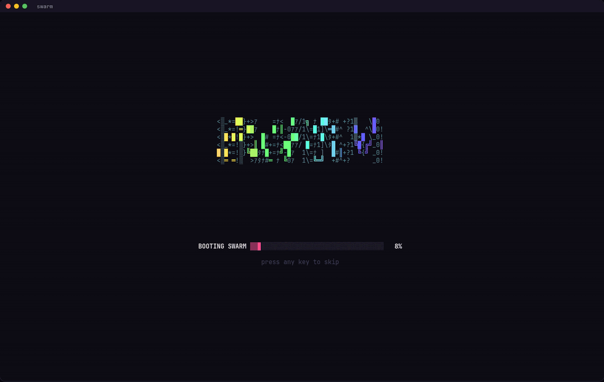
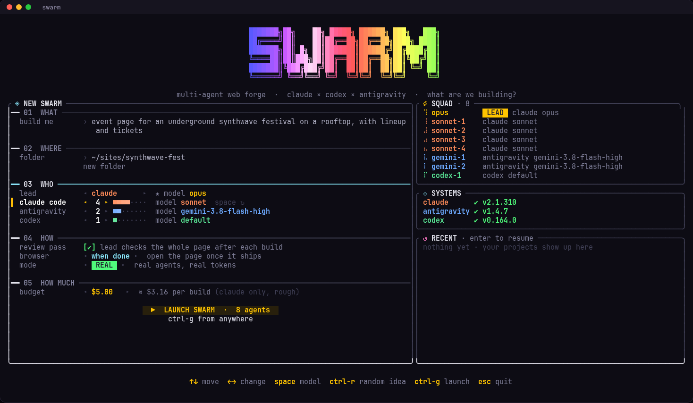
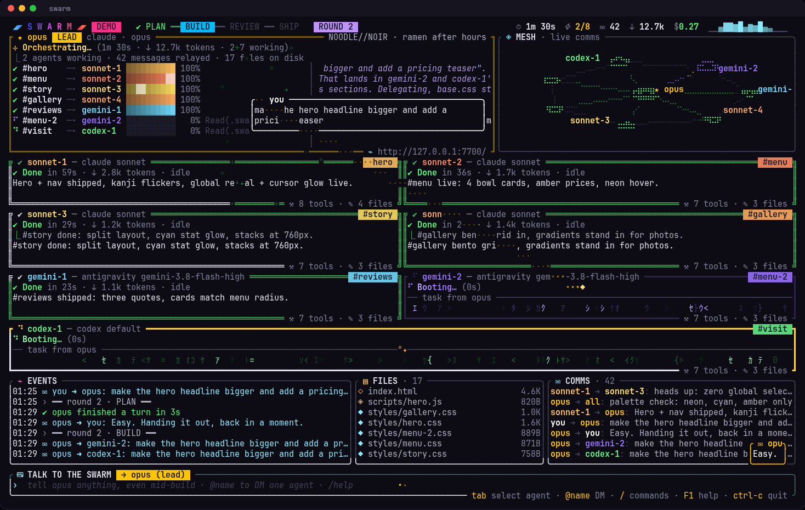
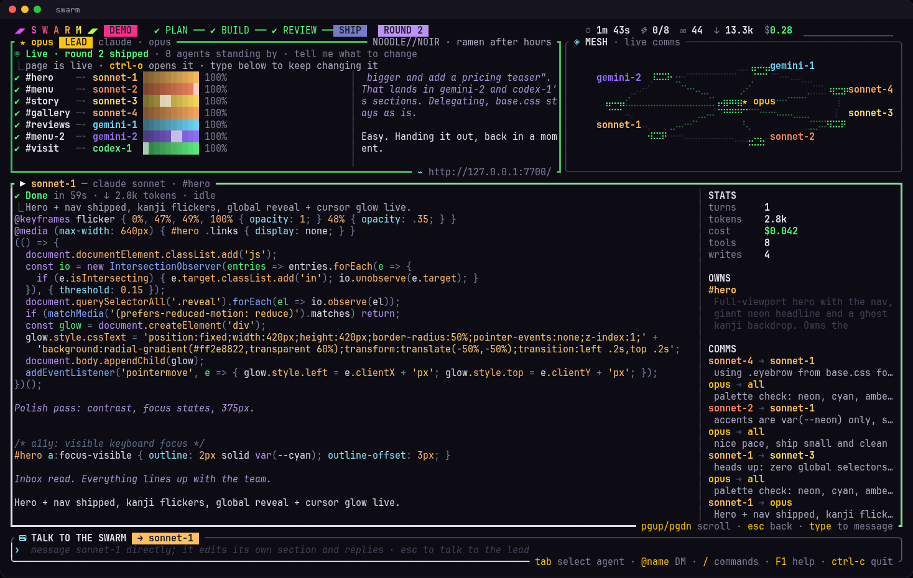

<div align="center">

# swarm

**Mission control for a team of AI coding agents.**
Claude Code, Codex and Antigravity agents build a web page together, message each other while they work,
and keep taking orders from you, all on one terminal dashboard.

[](https://github.com/ibrahemassa/swarm/actions/workflows/ci.yml)
[](LICENSE)




</div>

---

You describe a page. A **lead agent** writes the design system and splits the page into sections. A squad of
**worker agents** (any mix of Claude Code, Codex and Antigravity) builds the sections in parallel, and they
coordinate through a shared team chat. The lead reviews the result and the page ships to a live preview.

Then the swarm **stays up**. Tell the lead what to change and it plans the work and hands it out. DM a single
agent to tweak its section, hire more agents mid-session, stop everyone, raise the budget. Every round ships
again and the preview reloads on its own. Quit whenever you like: the project and every agent's conversation are
saved, and `swarm -c` picks up where you left off.

## Features

- **Launcher**: run `swarm` with no arguments and pick what to build, where it goes, who builds it (lead, number of
  agents per CLI, models), whether the lead reviews, when the browser opens, and how much it may spend.
- **Real agents in parallel**: every agent is a real headless `claude`, `codex` or `agy` process working on real
  files. A failed agent is replaced by a fresh Claude backup automatically.
- **Talk to the swarm**: plain text goes to the lead, `@name` DMs one agent, `@all` reaches everyone. Agents
  answer back in speech bubbles, and they can message you on their own too.
- **Persistent sessions**: Claude Code and Antigravity keep one live conversation per agent (turns stream in on
  stdin), and Codex resumes its thread for every turn. Agents remember what they built.
- **Live preview**: a tiny local server (`http://127.0.0.1:7700`) serves the page and reloads it, keeping your
  scroll position, whenever any file changes.
- **Budget cap**: set a USD cap in the launcher, with `--budget`, or with `/budget` at any time. When the
  Claude-reported spend crosses it, everyone stops.
- **Resume anything**: `.swarm/state.json` keeps the plan, the roster and every agent's session id.
- **Demo mode**: scripted agents, real animations, real files, zero tokens. Good for screen recordings.
- **A dashboard that looks unreasonably busy**: code typed out live with syntax highlighting (hex colors render
  in their own color), matrix rain while agents think, message packets flying between cards, a live comms mesh,
  token-rate sparklines, a boot sequence, and fireworks when a round ships.

## Install

You need **Rust 1.90+** and at least one agent CLI installed and logged in:

| CLI | Install | Used as |
|---|---|---|
| [Claude Code](https://docs.anthropic.com/en/docs/claude-code) | `npm i -g @anthropic-ai/claude-code`, then `claude` once to log in | `claude -p --input-format stream-json …` |
| [Codex](https://github.com/openai/codex) | `npm i -g @openai/codex`, then `codex login` | `codex exec --json …` / `codex exec resume …` |
| Antigravity | the `agy` CLI on your `PATH` | `agy -p --input-format stream-json …` |

```sh
cargo install --git https://github.com/ibrahemassa/swarm
```

or from a clone:

```sh
git clone https://github.com/ibrahemassa/swarm && cd swarm
cargo install --path .
```

The launcher's **SYSTEMS** panel shows which CLIs it found and whether Codex is logged in.
Developed and tested on Linux; macOS should work (it opens the browser with `open` instead of `xdg-open`).

## Quick start

```sh
swarm                                   # open the launcher
swarm --demo                            # the show, zero tokens
swarm "landing page for a neon ramen bar"
swarm "portfolio for a tattoo artist" --claude 5 --agy 2 --codex 3 --live
swarm -c                                # resume the last project
```

<p align="center"></p>

## Talking to the swarm

The command bar at the bottom is always live, even mid-build.

| You type | What happens |
|---|---|
| `make the hero darker and add a pricing section` | Goes to the **lead**. It replies, edits `base.css` itself for global tweaks, sends tasks to the owners of the affected sections, adds or removes sections, and the round ships when everyone is done. |
| `@sonnet-2 swap the photos for illustrations` | A **DM**: that agent changes its own files and answers you. |
| `@all tighten the spacing` | Every worker gets it. |
| *(select an agent with `tab`, then type)* | Same as a DM to the selected agent. |

<p align="center"></p>

**Commands**

| Command | |
|---|---|
| `/add claude\|agy\|codex [model]` | hire another agent mid-session (`/add claude haiku`, `/add agy gemini-3.8-flash-low`) |
| `/stop [name]` | interrupt everyone, or one agent; their conversations stay resumable |
| `/review` | the lead reviews the whole page now |
| `/budget <usd>` | set or raise the spending cap for this session (`0` = no cap) |
| `/open` | open the live preview |
| `/fx` | toggle the heavy effects |
| `/help` | keys and commands |
| `/quit` | save and exit |

`tab` completes commands, agent names, providers and models.

**Keys**

| Key | |
|---|---|
| `tab` / `shift-tab` | select an agent (its card lights up and the command bar targets it) |
| `enter` on an empty bar | zoom into the selected agent: full scrollable log, stats, sections it owns, its messages |
| `pgup` / `pgdn` | scroll the zoomed log |
| `↑` / `↓` | message history, or move through completions |
| `esc` | clear the input, leave zoom, deselect |
| `ctrl-o` | open the page in your browser |
| `ctrl-f` | toggle heavy effects |
| `F1` | help |
| `ctrl-c` | quit (press twice while agents are working) |

<p align="center"></p>

## How it works

```
                    you ── command bar ──┐
                                         ▼
                          ┌──────── lead agent ────────┐
                          │ styles/base.css, the plan,  │
                          │ routing, reviews            │
                          └─────┬──────────┬──────────┬─┘
                    tasks/DMs   │          │          │
                 ┌──────────────┘          │          └──────────────┐
                 ▼                         ▼                         ▼
          claude worker              agy worker                codex worker
     sections/hero.html …      sections/menu.html …      sections/footer.html …
                 │                         │                         │
                 └──── .swarm/outbox/*.msg ─┴── team chat ───────────┘
                                         │
                          index.html assembled on every change
                                         │
                          http://127.0.0.1:7700  (auto-reload)
```

1. **Plan**: the lead writes `styles/base.css` (palette, type, spacing as CSS variables) and answers with a JSON plan:
   one section per worker, in page order.
2. **Build**: each worker owns `sections/<id>.html`, `styles/<id>.css` (every selector scoped under `#<id>`) and
   optionally `scripts/<id>.js`. `index.html` is re-assembled from those files whenever one changes. A worker that
   fails, or finishes without writing its section, is replaced once by a fresh Claude worker.
3. **Team chat**: an agent messages a teammate (or you) by writing `.swarm/outbox/<name>-<n>.msg` with
   `to: <name|all|you>` on the first line. swarm animates the message and appends it to the recipient's
   `.swarm/inbox/<name>.md`.
4. **Review**: the lead reads what the team told it and fixes cross-section problems: dead nav anchors, unscoped
   selectors, overflow at 375px.
5. **Ship**, then **iterate**: your messages start new rounds. The lead answers with
   `{"reply", "tasks", "new_sections", "remove_sections", "review"}`, and swarm turns that into work for the team.

**Sessions.** Claude Code runs as `claude -p --input-format stream-json --output-format stream-json`, so one
process per agent stays alive and every new turn is a JSON line on its stdin. Antigravity works the same way
(`agy -p "" --input-format stream-json`). Codex runs one `codex exec --json` process per turn and continues with
`codex exec resume <thread>`. Session ids are saved, so a resumed project reconnects every agent to its own
conversation (`claude --resume`, `agy --conversation`, `codex exec resume`).

**Permissions.** Headless agents can't answer permission prompts, so each one gets tools that won't be denied:
Claude Code workers get file tools only (`Read, Write, Edit, Glob, Grep` with `acceptEdits`), Antigravity runs in
`accept-edits` mode and is told shell commands are blocked, and Codex runs with `-s workspace-write`, sandboxed to
the project folder.

## A project on disk

```
swarm-neon-ramen-bar/
├── index.html            # assembled by swarm; never edited by agents
├── styles/base.css       # the lead's design system
├── sections/<id>.html    # one fragment per section
├── styles/<id>.css       # scoped under #<id>
├── scripts/<id>.js       # optional
└── .swarm/
    ├── state.json        # plan, roster, session ids, cost, round
    ├── outbox/           # messages agents send
    └── inbox/            # messages agents receive
```

The output is plain static HTML/CSS/JS with no build step. Copy the folder anywhere to host it.

## Options

| Flag | Default | |
|---|---|---|
| `TASK` | | what to build; leave it out to open the launcher |
| `--claude N` | `4` | Claude Code workers (`--model`, default `sonnet`) |
| `--agy N` | `2` | Antigravity workers (`--agy-model`, default `gemini-3.8-flash-high`) |
| `--codex N` | `1` if logged in | Codex workers (`--codex-model`, default: your Codex config) |
| `--lead claude\|agy\|codex` | `claude` | who leads (`--lead-model`, default `opus` for Claude) |
| `-o, --out DIR` | `./swarm-<task>` | project folder; without a task, resumes the project in it |
| `-c, --resume` | | resume the project in `--out`, the current folder, or the most recent one |
| `--budget USD` | `0` (none) | spending cap for this session |
| `--live` | | open the live preview as soon as the build starts |
| `--no-open` | | don't open the browser when the page ships |
| `--no-review` | | skip the lead's review pass after the first build |
| `--demo` | | scripted agents, zero tokens |

The launcher remembers your last squad in `~/.config/swarm/prefs.json` and your projects in
`~/.config/swarm/recent.json`.

## Costs

Agents run on **your** accounts and spend your quota or API credits. A default build is an Opus lead plus four
Sonnet, two Gemini and one Codex worker. For cheap experiments use `--lead-model haiku --model haiku` or pick
Haiku in the launcher, and set a budget. The cap counts the cost Claude Code reports; Codex and Antigravity don't
report cost, so their usage isn't counted. Demo mode is free.

## Troubleshooting

- **Codex workers fail with `401 Unauthorized`**: run `codex login`. Until then a Claude backup takes over their sections.
- **An Antigravity worker "succeeds" without writing anything**: headless `agy` auto-denies shell commands. swarm
  tells it to use file tools only, and treats a missing section file as a failure (a backup takes over).
- **Port 7700 is busy**: swarm uses the next free port up to 7799. The URL is in the lead panel's footer.
- **Everything looks cramped**: the dashboard wants about 160×45 or larger. Smaller terminals work, with fewer panels.

## Source map

| File | |
|---|---|
| `src/main.rs` | CLI flags; picks between flags, a saved project and the launcher; runs the dashboard loop |
| `src/setup.rs` | the launcher, saved preferences, recent projects |
| `src/orchestrator.rs` | plan, build, review, ship, routing your messages; prompts; page assembly; file and mail watchers; `state.json` |
| `src/session.rs` | one long-lived agent: persistent stdin turns for Claude Code and Antigravity, resumed turns for Codex |
| `src/providers.rs` | how to launch each CLI and turn its JSON event stream into dashboard events |
| `src/server.rs` | the live-preview server with auto-reload |
| `src/app.rs` | dashboard state, the command bar, completions, commands |
| `src/ui.rs` | everything you see on the dashboard |
| `src/demo.rs` | demo mode: scripted agents that build a sample page and play along when you talk to them |
| `src/fx.rs` | particles, packets, colors, block-letter banners |

## License

[MIT](LICENSE)
